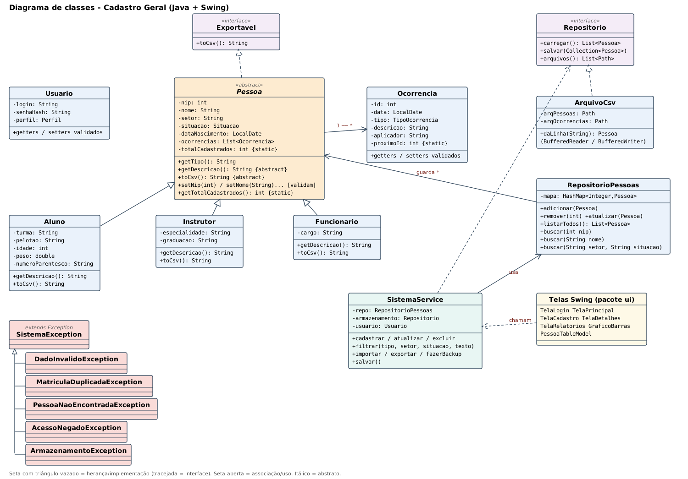

# Cadastro Geral – Escola de Aprendizes-Marinheiros do Ceará

Projeto de **Programação Orientada a Objetos** (Java + Swing). Substitui a planilha de Excel por um programa desktop que
guarda os registros em arquivo e permite **consultar, cadastrar, editar e excluir** pessoas, com validação, controle de
acesso por perfil, histórico (log) e relatórios.

## Como executar

Requisito: **JDK 11 ou superior** (testado no JDK 21). Não usa nenhuma biblioteca externa.

| Sistema | Compilar e gerar o JAR | Executar |
| --- | --- | --- |
| Linux / macOS | `./compilar.sh` | `./executar.sh` ou `java -jar dist/BancoDados.jar` |
| Windows | `compilar.bat` | `executar.bat` ou `java -jar dist\BancoDados.jar` |

O JAR já está pronto em `dist/BancoDados.jar`. Os dados ficam na pasta `dados/` (relativa ao local onde o programa é
executado); para usar outra pasta: `java -jar dist/BancoDados.jar /caminho/da/pasta`.

**Usuários de teste** (criados automaticamente se `dados/usuarios.csv` não existir):

| Login | Senha | Perfil |
| --- | --- | --- |
| `admin` | `admin123` | ADMIN – cadastra, edita, exclui, importa e registra ocorrências |
| `consulta` | `consulta123` | CONSULTA – só visualiza (botões de alteração desabilitados) |

As senhas são gravadas apenas como hash SHA-256. **Troque as senhas padrão** antes de usar com dados reais
(edite `dados/usuarios.csv`; para gerar o hash de uma nova senha, use `util.Senha.hash`).

Na primeira execução (sem `dados/pessoas.csv`), o sistema cria **14 pessoas fictícias** com ocorrências de exemplo.
A pasta `dados/` já acompanha o projeto com esses dados.

## O que o sistema faz

* **Tela principal**: tabela com todas as pessoas; clique no cabeçalho para ordenar (NIP ordena como número).
* **Filtros combinados em tempo real**: busca por nome (ignora maiúsculas e acentos) ou NIP + tipo + setor + situação.
* **Novo / Editar / Excluir** (com confirmação). O formulário muda os campos conforme o tipo (Aluno, Instrutor, Funcionário).
* **Duplo clique** (ou botão Detalhes): todos os dados e a lista de ocorrências (elogio, negativa, parte de ocorrência).
* **Menu Arquivo**: importar CSV (planilha do Excel salva como CSV com `;`), exportar a consulta atual, salvar, backup.
* **Menu Relatórios**: resumo por tipo/situação/setor, **gráfico de barras** (Graphics2D), aniversariantes do mês, pessoas com mais ocorrências.
* **Log de auditoria** em `dados/log.txt` (quem fez o quê e quando) e **backup automático** em `dados/backups/`
  (uma cópia antes da primeira gravação de cada sessão; mantém os 20 mais recentes).

Problemas da planilha resolvidos: NIP repetido, campo vazio, número/data inválidos são recusados com mensagem clara;
busca e filtro por vários critérios; edição só para quem tem perfil ADMIN; histórico de alterações.

## Onde cada requisito da disciplina aparece

| Requisito | Onde |
| --- | --- |
| Herança | `Pessoa` → `Aluno`, `Instrutor`, `Funcionario` (`modelo/`) |
| Classe abstrata | `Pessoa` (`new Pessoa()` não compila) |
| Sobrescrita | `getTipo()`, `getDescricao()` e `toCsv()` em cada subclasse; `toString()` em `Pessoa` |
| Sobrecarga | `RepositorioPessoas.buscar(int)`, `buscar(String)`, `buscar(String, String)`; construtores |
| Construtores | vazio e completo em todas as classes do modelo |
| Encapsulamento | atributos `private` + getters/setters que validam e lançam `DadoInvalidoException` |
| Atributo `static` | `Pessoa.totalCadastrados` (exibido na barra de status) e `Ocorrencia.proximoId` |
| Polimorfismo | uma única `List<Pessoa>` / `HashMap<Integer, Pessoa>`; a tabela chama `getDescricao()` de cada tipo |
| Interface | `Exportavel` (`toCsv`) e `Repositorio` (`carregar`, `salvar`) |
| Coleções | `ArrayList`, `HashMap` (repositório), `TreeMap` e Streams nos relatórios |
| Interface gráfica | `ui/`: `JFrame`, `JTable` com `AbstractTableModel`, `JDialog`, `JComboBox`, `JMenuBar`, `DocumentListener` |
| Exceções | `excecao/`: `SistemaException` (base) e as filhas `DadoInvalidoException`, `MatriculaDuplicadaException`, `PessoaNaoEncontradaException`, `AcessoNegadoException`, `ArmazenamentoException` |
| Arquivos | `ArquivoCsv` com `BufferedReader`/`BufferedWriter` e try-with-resources |

## Decisão sobre onde guardar os dados (Fase 5)

Foi implementada a versão **CSV** (a opção sugerida no roteiro), que cumpre claramente o requisito de manipulação de
arquivos, não precisa de biblioteca e abre no Excel. O sistema só conversa com a interface `Repositorio`; para trocar
por SQLite ou outro meio basta criar **uma classe nova** que a implemente e instanciá-la em `SistemaService`.
**Pergunta pendente para o professor:** o requisito de arquivos aceita banco de dados ou precisa ser leitura/escrita direta?

Arquivos gerados em `dados/`: `pessoas.csv`, `ocorrencias.csv`, `usuarios.csv`, `log.txt`, `backups/`.
Formato (separado por `;`, primeira coluna = tipo): `ALUNO;NIP;NOME;SETOR;SITUACAO;NASCIMENTO;TURMA;PELOTAO;IDADE;PESO;NUM_PARENTE`,
`INSTRUTOR;...;ESPECIALIDADE;GRADUACAO`, `FUNCIONARIO;...;CARGO`. Linhas mal formatadas são ignoradas e avisadas, sem derrubar o sistema.

## Estrutura

```
src/
  modelo/       Pessoa (abstrata), Aluno, Instrutor, Funcionario, Ocorrencia, Usuario, enums, Exportavel
  excecao/      exceções personalizadas
  repositorio/  Repositorio (interface), ArquivoCsv, ArquivoUsuarios, RepositorioPessoas (HashMap)
  servico/      SistemaService (regras), AuditLog, Relatorios, ServicoAutenticacao, DadosExemplo
  ui/           TelaLogin, TelaPrincipal, TelaCadastro, TelaDetalhes, TelaRelatorios, GraficoBarras, PessoaTableModel
  app/          Main (interface gráfica) e ConsoleDemo (demonstração no console, Fases 1 a 4)
teste/          TesteSistema (22 verificações automáticas) e CapturaTelas
docs/           diagrama-classes.svg / .png e capturas de tela
```

A lógica fica fora das telas: a interface só chama `SistemaService` e mostra o resultado (e as exceções).

## Testes

```
./compilar.sh
mkdir -p teste-out && javac -encoding UTF-8 -cp out -d teste-out teste/TesteSistema.java
java -cp out:teste-out TesteSistema        # 22 verificações: CRUD, permissões, persistência, importação...
java -cp out app.ConsoleDemo               # demonstração de herança, polimorfismo, sobrecarga e exceções
```

## Suposições feitas a partir do roteiro

O roteiro deixava alguns pontos em aberto; ajuste se a equipe decidir diferente:

* **NIP** é a chave (matrícula) e deve ser um inteiro positivo.
* **Nº parentesco** foi tratado como o telefone de um parente de contato (texto, aceita dígitos, espaços, `( ) + -`).
* **Funcionário** não tinha atributos definidos: ficou com `cargo`. **Instrutor**: `especialidade` e `graduação` (3SG, 2SG, 1SG, SO ou texto livre).
* **Data de nascimento** (opcional) foi adicionada a `Pessoa` para alimentar o relatório de aniversariantes.
* Ao **editar**, o tipo e o NIP não mudam (o NIP é a chave); as ocorrências são preservadas.
* `toCsv()` faz o papel do `getResumoCsv()` citado na tabela de requisitos (a Fase 2 do roteiro usa o nome `toCsv`).
* `Pessoa.totalCadastrados` conta os objetos vivos: aumenta ao criar e diminui ao excluir; objetos que falham na validação não contam.

## Diagrama de classes



Versão vetorial: `docs/diagrama-classes.svg`.
